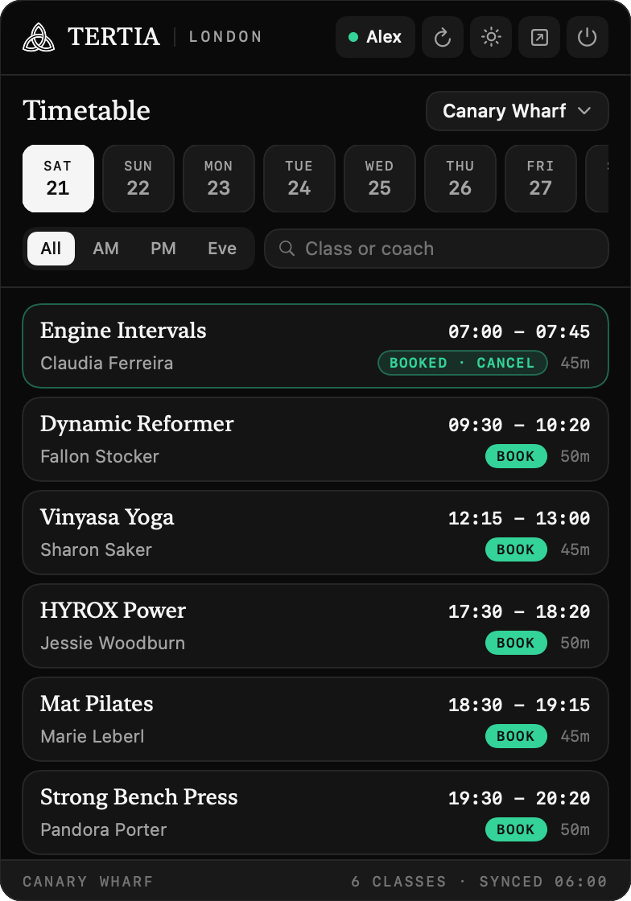
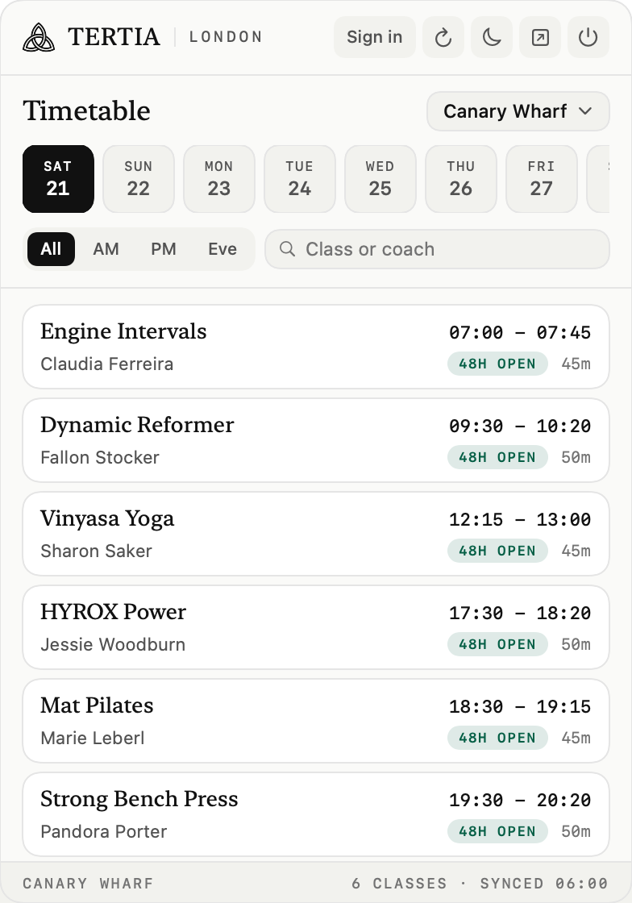
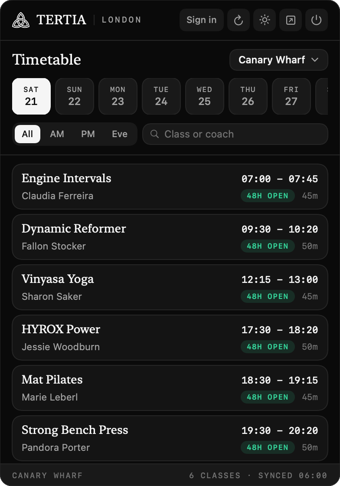
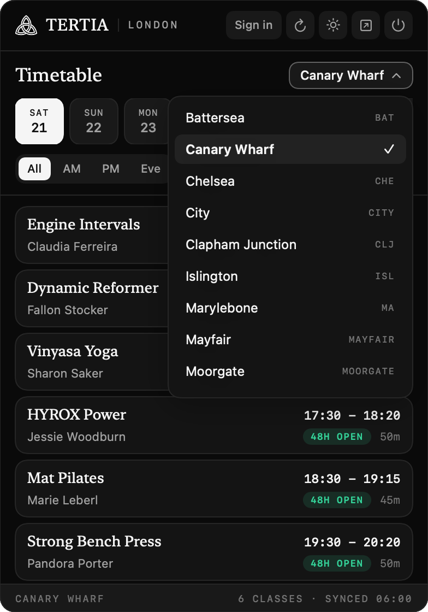
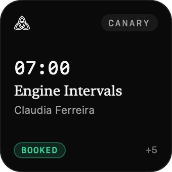
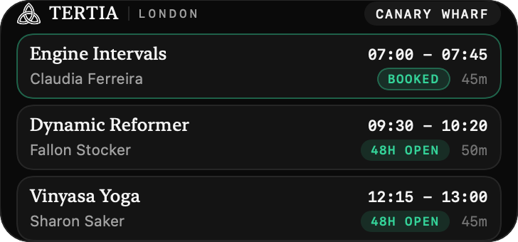
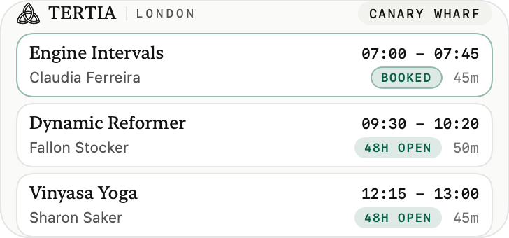
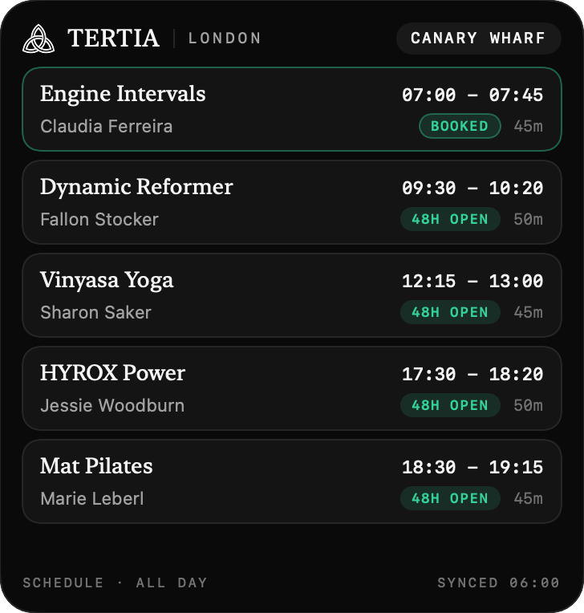

# Tertia: Native macOS Menu-Bar App, Desktop Widget, CLI & MCP Server for Third Space London

**Tertia** is a lightweight, open-source macOS application (written in 100% native Swift 6 and SwiftUI) for browsing **Third Space London** class timetables across all 17 clubs, displaying live schedules in an official macOS **WidgetKit** desktop widget, and booking or cancelling available (`48H OPEN`) classes from your menu bar, terminal, or AI assistant.

Tertia loads class timetables without an account from the public Third Space website (`thirdspace.london/timetable/`). Member sign-in is completely optional, stored locally in your **macOS Keychain**, and syncs private booking status **only** when you sign in, click Refresh, or book/cancel a class.

---

## Visual Overview

<table>
  <tr>
    <td align="center" width="50%">
      <strong>Signed-In Booking (Dark Mode)</strong><br />
      
    </td>
    <td align="center" width="50%">
      <strong>Public Timetable (Ivory Light Mode)</strong><br />
      
    </td>
  </tr>
  <tr>
    <td align="center" width="50%">
      <strong>Public 48H Window Badges (Dark Mode)</strong><br />
      
    </td>
    <td align="center" width="50%">
      <strong>17-Club London Selector</strong><br />
      
    </td>
  </tr>
</table>

### Official macOS Desktop Widgets (`WidgetKit`)

Add Small, Medium, or Large **Tertia Timetable** widgets directly to your macOS Desktop or Notification Center. Widgets read cached local state synced by the menu-bar app or CLI and display an emerald `BOOKED` badge on your active bookings. When no timetable for the selected club is cached and the public site is unreachable, a live widget shows `Timetable unavailable` (sample classes appear only in the widget gallery preview).

<table>
  <tr>
    <td align="center" valign="top" width="30%">
      <strong>Small Widget</strong><br /><br />
      
      <br /><br />
      <strong>Medium (Dark)</strong><br /><br />
      
    </td>
    <td align="center" valign="top" width="35%">
      <strong>Medium (Light)</strong><br /><br />
      
    </td>
    <td align="center" valign="top" width="35%">
      <strong>Large Widget</strong><br /><br />
      
    </td>
  </tr>
</table>

---

## Key Capabilities

| Surface | Read-Only Public Mode (Default) | Opt-In Signed-In Member Mode |
|---|---|---|
| **Menu-Bar App** (`Tertia.app`) | Instant 10-day timetable across 17 London clubs, AM/PM/Eve period filter, class & coach search, dark/light theme | Scopes clubs to your signed-in account, plus inline `BOOK` and `BOOKED · CANCEL` buttons on `48H OPEN` classes and 3-hour late-cancel guard |
| **Desktop Widget** (`TertiaWidget.appex`) | Small, Medium, and Large macOS `WidgetKit` widgets synced from `thirdspace.london/timetable/` | Highlights active bookings with a `BOOKED` badge (the widget container receives no private booking details: no tokens, booked class titles, trainer names, booking timestamps, or member emails; only active `bookedIds`, one-way SHA-256 row tokens binding each to its club and London date, an opaque account hash, preferences, and public timetables) |
| **CLI** (`tertia`) | `clubs`, `timetable` (table or `--json`), `set-club` | `login`, `logout`, `bookings`, `book`, `cancel` |
| **MCP Server** (`tertia mcp`) | `list_clubs`, `get_timetable`, `set_widget_club` | `my_bookings`, `book_class`, `cancel_booking` |

---

## Quick Start (macOS 14 Sonoma or Newer)

### Prerequisites
- Apple Silicon Mac (`arm64`) running **macOS 14 (Sonoma)** or later (the build scripts target `arm64-apple-macosx14.0` only)
- Xcode Command Line Tools (`xcode-select --install`) or Xcode 16+
- For `make test` only: Python 3 built with OpenSSL `TLSv1.3` and `ALPN` support (the local HTTPS/HTTP2 wire-profile test runs a Python TLS server; `make test` checks this first and names any missing capability)

### Build, Test, and Install

```bash
git clone https://github.com/evgesha9400/tertia.git
cd tertia

# Run core parser, calendar, Keychain, and wire-contract tests
make test

# Build, bundle, ad-hoc sign, install to ~/Applications/Tertia.app, and register the WidgetKit extension
make install

# Launch Tertia in the macOS menu bar
make run
```

To add the Desktop Widget:
1. Right-click anywhere on your macOS Desktop and choose **Edit Widgets...**.
2. Search for **Tertia** (or **Tertia Timetable**).
3. Drag the **Small**, **Medium**, or **Large** widget onto your Desktop or Notification Center.

*(Optional)* Symlink the CLI onto your `PATH`:

```bash
ln -sf ~/Applications/Tertia.app/Contents/Helpers/tertia /usr/local/bin/tertia
```

---

## CLI Usage & Examples

If you run directly from the installed bundle without symlinking, invoke `~/Applications/Tertia.app/Contents/Helpers/tertia`.

### 1. Browse Public Timetables (No Account Needed)

```bash
# List all 17 Third Space clubs with numeric IDs
tertia clubs

# Print Canary Wharf (id=39) classes for today with 48H OPEN / OPENS status pills
tertia timetable --club 39

# Filter Evening Reformer classes on a specific London date as JSON
tertia timetable --club 52 --date 2026-11-22 --period evening --search Reformer --json

# Switch the club displayed on your Desktop Widget and menu-bar app
tertia set-club 201
```

### 2. Sign In, Book, and Cancel Available (`48H OPEN`) Classes

```bash
# Sign in interactively (stores session token in macOS Keychain under service "club.tertia.macos")
tertia login --email you@example.com

# Or pipe password cleanly via stdin for automation
printf '%s' "$TERTIA_PASSWORD" | tertia login --email you@example.com --password-stdin

# View cached upcoming bookings (or pass --refresh to sync live from mobile API)
tertia bookings
tertia bookings --refresh --json

# Book a class ID shown in `tertia timetable`
tertia book 3064910

# Cancel an upcoming booking (pass --late only if inside the 3-hour late-cancel window)
tertia cancel 3064910
tertia cancel 3064910 --late

# Sign out and wipe both macOS Keychain session and local bookings cache
tertia logout
```

---

## MCP Server Integration (Claude Desktop, Cursor, Antigravity)

Tertia ships a native stdio **Model Context Protocol (MCP)** server (`tertia mcp`) inside the same app bundle. It exposes 6 structured tools:

- **Public tools:** `list_clubs`, `get_timetable`, `set_widget_club`
- **Member tools (uses Keychain session from `tertia login` or UI Sign In):** `my_bookings`, `book_class`, `cancel_booking`

Add this block to your MCP client configuration (for example `~/Library/Application Support/Claude/claude_desktop_config.json`, Cursor MCP settings, or Antigravity `mcp_config.json`):

```json
{
  "mcpServers": {
    "tertia": {
      "command": "/Users/YOUR_USERNAME/Applications/Tertia.app/Contents/Helpers/tertia",
      "args": ["mcp"]
    }
  }
}
```

Example prompts you can ask your AI assistant once configured:
- *"Check evening classes at Canary Wharf tonight and list anything with Pilates or Yoga."*
- *"Switch my macOS Third Space desktop widget to Clapham Junction."*
- *"Show my current Third Space bookings, and book class 3064910 if it is open."*

---

## Privacy, Sync Rules & Security Model

1. **Three-Trigger Private Sync Policy:**
   The timetable itself always loads from the public website (`https://www.thirdspace.london/timetable/`). When you sign in, private mobile API calls (`https://api.thirdspace-london.app`) happen **only** at three explicit moments:
   - Once when you sign in,
   - When you click **Refresh** in the menu bar (or run `tertia bookings --refresh`),
   - Immediately after you book or cancel a class.
   Zero background polling timers run against your member account.
2. **macOS Keychain Only (No Plaintext Tokens on Disk):**
   Your member session JSON (`MemberSession`) is stored exclusively in the standard macOS login Keychain (`kSecClassGenericPassword`, service `club.tertia.macos`). Passwords are never saved to disk or Keychain. When invoked via `MobileBookingClient`, secrets pass over an anonymous `stdin` pipe to `/usr/bin/curl --disable --config -` (`--disable` ignores any `~/.curlrc`) so credentials never appear in `ps` process arguments.
   Cached bookings (`bookings.json` in `~/Library/Application Support/TertiaClub`) are tagged with the signed-in account and are never shown to a different account. The widget container receives no private booking details (no booked class titles, trainer names, booking timestamps, or member emails). Its mirror holds only preferences, public timetables, `account.json` (`{"ownerId":"...","bookingsValid":true}`: a SHA-256 hash of the account identity, never the email, plus whether the cached bookings are currently valid), and `{"bookedIds":[...],"ownerId":"...","rowTokens":[...]}` for bookings (each row token is a SHA-256 hash of a class ID, its club name, and its London date). The widget shows `BOOKED` badges only when both files name the same account and `bookingsValid` is `true`, and only on today's row of the shown club whose row token matches.
3. **3-Hour Late-Cancellation Strike Protection:**
   Cancelling a class in the menu-bar app 3 hours or less before start time (exactly 3 hours counts as late) switches the button to an amber `LATE (<=3H) · CONFIRM?` second-tap confirmation to protect against accidental late-cancel strikes. In CLI (`tertia cancel <id> --late`) and MCP (`cancel_booking`), late cancellation requires an explicit `--late` / `late_booking: true` flag; outside the window `--late` is ignored and the server receives `lateBooking: false`. All three surfaces share one rule set: they need synced bookings, check the 48-hour window, started classes, and the late window at the moment you act using locally cached data, and refuse classes whose start time is invalid. In the repeated autumn clock-change hour, a public timetable time has no UTC offset, so it is ambiguous: those rows show `UNAVAILABLE` and cannot be booked. A member booking whose own start stamp carries an offset (or `Z`) has one exact instant, so it can still be cancelled in that hour. These checks add zero private API calls.
4. **No Queue Sniping:**
   Booking actions target classes whose 48-hour window is already open (`48H OPEN`). Tertia does not schedule automated timers or race condition snipers against future release windows.
5. **Account-Scoped Clubs:**
   Signing out shows all 17 Third Space clubs; signing in scopes the menu-bar club picker, `tertia clubs` (pass `--all` to override), and MCP `list_clubs` strictly to the clubs included in your membership.
6. **Configured Android Mobile Wire Profile (`6.7.4`):**
   Authenticated requests follow the reference profile in [`Scripts/Fixtures/android-6.7.4-wire-profile.json`](Scripts/Fixtures/android-6.7.4-wire-profile.json): `User-Agent: okhttp/4.12.0`, `Accept-Encoding: gzip`, `x-app-platform: android`, `x-app-version: 6.7.4` in that order (no `Accept` header), `api-version=2.0`, TLS 1.2 to 1.3 with the profile's 15 cipher suites in order and the X25519, P-256, P-384 curves, and ALPN `h2` then `http/1.1`. The requests are sent by the system `curl`, so parts curl controls (for example the HTTP/2 pseudo-header order `:method`, `:scheme`, `:authority`, `:path`, and other TLS extensions) are curl's, not OkHttp's.

---

## Third Space London Club IDs

| ID | Short Code | Club Name | ID | Short Code | Club Name |
|---:|---|---|---:|---|---|
| `199` | `BAT` | Battersea | `221` | `PAT` | Paternoster Square |
| `39` | `CANARY` | Canary Wharf | `222` | `QPR` | Queens Park |
| `220` | `CHE` | Chelsea | `218` | `RMD` | Richmond |
| `43` | `CITY` | City | `52` | `SOHO` | Soho |
| `201` | `CLJ` | Clapham Junction | `219` | `TWH` | The Whiteley |
| `123` | `ISL` | Islington | `63` | `TOWER` | Tower Bridge |
| `51` | `MA` | Marylebone | `187` | `WIMB` | Wimbledon |
| `171` | `MAYFAIR` | Mayfair | `200` | `WW` | Wood Wharf |
| `177` | `MOORGATE` | Moorgate | | | |

---

## Repository Architecture

Built for Apple Silicon (`arm64-apple-macosx14.0`). `TertiaCore` and `TertiaCLI` are headless modules: they import no `SwiftUI`, `AppKit`, `WidgetKit`, or `TertiaUI`, so the same booking rules serve the menu-bar app, CLI, and MCP server:

```text
Sources/
  TertiaCore/
    Models.swift                # Clubs, ClassSession, LondonCalendar (48h open & 3h late windows), booking models
    HTMLTimetableParser.swift   # Extracts public schedule JSON from thirdspace.london/timetable/
    PublicTimetableClient.swift # 30-minute cached unauthenticated schedule fetcher
    MobileBookingClient.swift   # Mobile 6.7.4 authenticated client (login, bookings, book, cancel)
    SharedStateStore.swift      # Non-interactive KeychainStore + atomic JSON mirror to Widget container
  TertiaCLI/
    TertiaCLI.swift             # UI-free CLI library (clubs, timetable, set-club, login, logout, bookings, book, cancel, mcp)
    MCPServer.swift             # Native stdio JSON-RPC MCP server (zero AppKit/SwiftUI/WidgetKit dependencies)
  TertiaUI/
    TertiaTheme.swift           # Dark obsidian (#0A0A0A) & ivory light (#FAFAF8) design tokens
    TertiaBrandMark.swift       # Bold vector trefoil mark (fill + stroke) and monochrome wordmark
    CompactClassCard.swift      # Compact 2-row class card + interactive BOOK / BOOKED / LATE CONFIRM chips
    MenuBarScheduleView.swift   # Menu-bar popover, Keychain sign-in panel, club picker, static preview mode
    WidgetViews.swift           # Small, Medium, and Large WidgetKit views sharing WidgetListShell
  TertiaApp/
    TertiaMainApp.swift         # Unified app & CLI binary (LSUIElement menu bar + tertia:// window + Helpers/tertia symlink)
  TertiaWidget/
    TertiaWidgetBundle.swift    # WidgetKit StaticConfiguration extension (TertiaWidget.appex)
Scripts/
  build.sh, test.sh, package_app.sh, VerifyCoreTests.swift
  publish.py                    # Lock-serialized, zero-gap bundle publication (renamex_np RENAME_SWAP) for package and install
  Fixtures/android-6.7.4-wire-profile.json   # Reference mobile wire profile (headers, TLS ciphers and curves, ALPN)
```

---

## Frequently Asked Questions (FAQ)

### Does Tertia require a Third Space login?
No. Viewing schedules for all 17 Third Space clubs in the macOS menu-bar app, Desktop Widgets, CLI (`tertia timetable`), and MCP (`get_timetable`) works out of the box using only public timetable pages with zero credentials.

### How are Third Space credentials stored?
Your password is used once during sign-in to obtain a session token (`x-fisikal-token`) and is never written to disk or Keychain. The resulting `MemberSession` JSON is stored exclusively in your macOS login Keychain under service `club.tertia.macos`. Running `tertia logout` or clicking **Sign out** deletes the Keychain item and clears `bookings.json`.

### Does Tertia poll private APIs in the background or snipe future classes?
No. Tertia never runs background polling timers against private member endpoints and cannot snipe or queue future classes before their 48-hour window opens. Private requests execute solely on login, manual Refresh, and explicit user-triggered book or cancel actions.

### How does Tertia prevent accidental late-cancellation strikes?
Classes cancelled 3 hours or less before start trigger a strike under Third Space rules. The menu-bar UI intercepts any cancel click inside that 3-hour window with a two-step `LATE (<=3H) · CONFIRM?` amber confirmation before calling the API, while CLI (`tertia cancel <id> --late`) and MCP (`cancel_booking`) require explicit opt-in.

### Can AI assistants like Claude or Cursor book Third Space classes?
Yes. Configure `Tertia.app/Contents/Helpers/tertia mcp` in your MCP client and sign in once via the app or `tertia login`. Assistants can then query live club timetables, inspect `my_bookings`, switch your Desktop Widget club, and execute `book_class` or `cancel_booking`.

### Why is Tertia built in native Swift 6 instead of Electron or Go?
Tertia builds its macOS Desktop Widgets with `WidgetKit` and SwiftUI. Building the menu-bar host, CLI, MCP server, and Desktop Widgets in Swift 6 lets all menu-bar, CLI, and MCP surfaces share one unified executable (with `Contents/Helpers/tertia` symlinked to `Contents/MacOS/Tertia` so ad-hoc macOS builds share one `CDHash` Keychain identity cleanly) alongside the widget extension, with zero browser runtime overhead. The checked build targets `arm64` macOS 14 or later (`arm64-apple-macosx14.0`); `TertiaCore` and `TertiaCLI` contain zero `SwiftUI`, `AppKit`, or `WidgetKit` imports.

### How do I sign a Developer ID release build or keep Keychain access across local rebuilds?
Ad-hoc builds (`SIGN_IDENTITY="-"`) carry no Apple `TeamIdentifier`, so macOS `securityd` binds the `club.tertia.macos` Keychain item partition ACL to the binary `CDHash`. Restarting the app keeps your session intact, while recompiling changed source produces a new `CDHash` and prompts `App updated. Sign in again to reconnect Keychain.` (signing in replaces the previous entry automatically).

To keep Keychain partition access across local source rebuilds (`teamid:<TEAMID>`), install an **Apple Development** certificate (free with an Apple ID in Xcode Settings -> Accounts -> Manage Certificates) or a **Developer ID Application** certificate in your login Keychain. `Scripts/package_app.sh` selects either certificate automatically whenever `SIGN_IDENTITY` is unset, or you can pass an identity explicitly (`SIGN_IDENTITY` signs the entitlement-free app bundle and the sandboxed network-only widget extension, while `SharedStateStore` continues to use the widget container mirror):

```bash
SIGN_IDENTITY="Developer ID Application: Your Name (TEAMID)" make package
```

A Homebrew Cask template for signed Developer ID releases is available at [`Packaging/Casks/tertia.rb`](Packaging/Casks/tertia.rb).

---

## Disclaimer & License

Tertia is an independent, unofficial open-source project. It is not affiliated with, endorsed by, or connected to Third Space Holdings Limited or Fisikal.

The Tertia source code is released under the **MIT License**, which grants full open-source permissions, including commercial use of the code. See [`LICENSE`](LICENSE).

Separately, anyone who uses Tertia with Third Space services remains responsible for complying with Third Space's own terms of service. Please avoid automated scraping or high-frequency polling.
